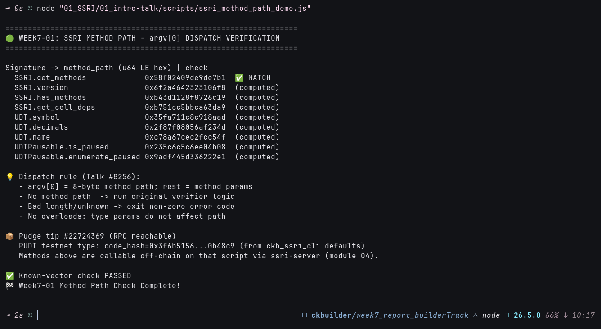

# 🧭 01 - SSRI Design: Method Paths & Off-Chain Execution Levels

**Module**: Week 7 - SSRI Track (Part 1/7)  
**Author**: Riko Kurnia Sandi  
**Official Reference**: [\[EN/CN\] Script-Sourced Rich Information (Nervos Talk #8256, post #2 by saku)](https://talk.nervos.org/t/en-cn-script-sourced-rich-information-script/8256/2)

---

## 1. Overview & Core Problem

On CKB, scripts are traditionally **verifiers**: they only pass/fail state transitions and expose almost no logic externally. Token metadata, NFT schemas, and tx-assembly logic get re-implemented per language, per app. SSRI fixes this by letting a script **execute off-chain and return results** — strongly binding information/logic to the script itself (inspired by the DOB decoder's off-chain execution mode).

## 2. Design (from the Talk post)

- **On-chain**: behavior standard like Rust `trait`s — abstract behaviors become `method` constraints. Method signature format: `[<trait>.]<method>` (e.g. `UDT.symbol`); **no overloading**.
- **Method path**: first 8 bytes of the method signature's CKB hash, passed as `argv[0]` (u64 LE); remaining argv = method params.
- **Dispatch rules**: no path → run original verifier; bad length/unknown → non-zero exit.
- **Off-chain levels**: `Code` (program only) → `Script` → `Cell` (index must be 0, InputGroup) → `Transaction`.
- **SSRI trait**: `SSRI.version() -> u8` (=0), `get_methods(offset, limit)`, `has_methods(...)`, `get_cell_deps(offset, limit)`.
- **Encoding**: ints LE, bool 1 byte, strings utf-8 as molecule `vector<byte>`, composites molecule.
- **New off-chain syscalls**: `find_out_point_by_type`, `find_cell_by_out_point`, `find_cell_data_by_out_point`.

## 3. Practical Demonstration

Executable: [`scripts/ssri_method_path_demo.js`](./scripts/ssri_method_path_demo.js) — recomputes every method path from the definition and checks the known vector from ssri-server's README:

```text
=================================================================
🟢 WEEK7-01: SSRI METHOD PATH - argv[0] DISPATCH VERIFICATION
=================================================================
Signature -> method_path (u64 LE hex) | check
  SSRI.get_methods             0x58f02409de9de7b1  ✅ MATCH
  SSRI.version                 0x6f2a4642323106f8  (computed)
  SSRI.has_methods             0xb43d1128f8726c19  (computed)
  SSRI.get_cell_deps           0xb751cc5bbca63da9  (computed)
  UDT.symbol                   0x35fa711c8c918aad  (computed)
  UDT.decimals                 0x2f87f08056af234d  (computed)
  UDT.name                     0xc78a67cec2fcc54f  (computed)
  UDTPausable.is_paused        0x235c6c5c6ee04b08  (computed)
  UDTPausable.enumerate_paused 0x9adf445d336222e1  (computed)
✅ Known-vector check PASSED
```

> 📸 **Execution Proof** (`ssri_method_path_demo.js`, known vector ✅):
>
> 

These exact paths are cross-verified against live chain data in [04_ssri-server](../04_ssri-server/readme.md) (all 8 appear in the prototype's `get_methods` output).

## 4. Summary Findings

- Method paths are deterministic content-addresses of behavior — the foundation of SSRI discoverability.
- Gotcha found while implementing: `ccc.hashCkb` returns a hex **string**, not bytes — first 8 bytes = chars `[0:18]`.
- Next: the SDK that implements this dispatch in [02_sdk-crates](../02_sdk-crates/readme.md).

## 🚀 Reproduction Guide

```bash
cd week7_report_builderTrack
npm install
node "01_SSRI/01_intro-talk/scripts/ssri_method_path_demo.js"
```
