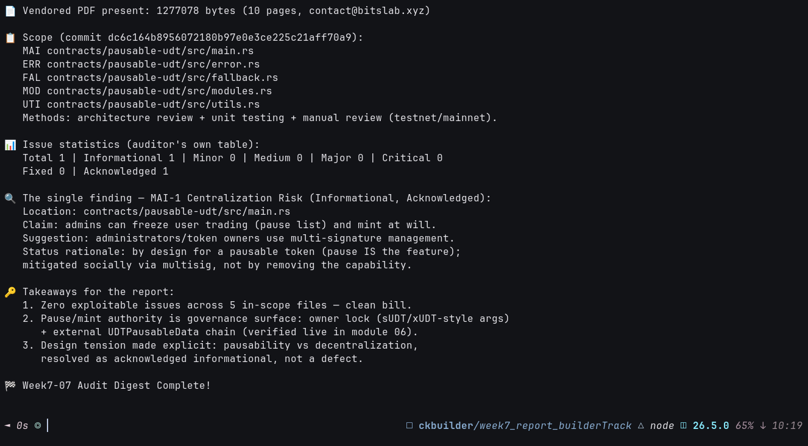

# 🔍 07 - Pausable UDT Audit Digest (ScaleBit, Dec 2024)

**Module**: Week 7 - SSRI Track (Part 7/7)  
**Author**: Riko Kurnia Sandi  
**Official Reference**: [20241224-Pausable-UDT-Final-Audit-Report.pdf](https://github.com/Alive24/pausable-udt/blob/master/20241224-Pausable-UDT-Final-Audit-Report.pdf) (vendored in this folder, 10 pages, ScaleBit)

---

## 1. Scope & Method

- Commit `dc6c164b...`, 5 files: `main.rs` (MAI), `error.rs` (ERR), `fallback.rs` (FAL), `modules.rs` (MOD), `utils.rs` (UTI).
- Architecture review + unit testing + manual review, tested on testnet/mainnet. Timeline Dec 16–18, 2024.

## 2. Result: 1 Finding, Zero Exploitable

| Severity | Count |
| :--- | :--- |
| Critical / Major / Medium / Minor | **0** |
| Informational | **1** — `MAI-1 Centralization Risk` (Acknowledged) |

**MAI-1**: admins can freeze trading via the pause list and mint at will (`main.rs`). Suggestion: multisig administration. Acknowledged as **by design** — pausability *is* the feature; the mitigation is social (multisig), not removal.

## 3. Why This Matters (ties to modules 01–06)

- The pause/mint authority the auditor flags is exactly the `UDTPausable` governance surface: sUDT-style owner-lock args + `UDTPausableData.next_type_script` chain — whose live head (`0x27568466...:0`) we verified **committed** in module 06.
- Clean bill (0 major+) corroborates the careful `argv`-dispatch + `should_fallback` design from modules 01/05.

Executable: [`scripts/audit_digest_demo.js`](./scripts/audit_digest_demo.js) (verifies vendored PDF presence + prints this digest).

> 📸 **Execution Proof** (`audit_digest_demo.js`):
>
> 

## 🚀 Reproduction Guide

```bash
cd week7_report_builderTrack
node "01_SSRI/07_audit-report/scripts/audit_digest_demo.js"
```
