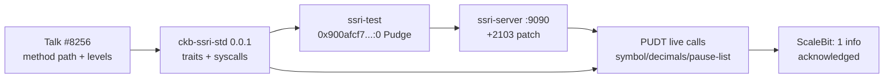

# 🧩 01 - SSRI: Script-Sourced Rich Information, End to End

**Module**: Week 7 - SSRI (Handbook Advanced: SSRI + Pausable UDT)  
**Author**: Riko Kurnia Sandi  
**Sources**: [Talk #8256](https://talk.nervos.org/t/en-cn-script-sourced-rich-information-script/8256/2) · [crates.io](https://crates.io/crates/ckb-ssri-std) · [ssri-test](https://github.com/Hanssen0/ssri-test) · [ssri-server](https://github.com/ckb-devrel/ssri-server) · [docs.rs](https://docs.rs/ckb-ssri-std/0.0.1/ckb_ssri_std/) · [pausable-udt](https://github.com/Alive24/pausable-udt) · [audit PDF](https://github.com/Alive24/pausable-udt/blob/master/20241224-Pausable-UDT-Final-Audit-Report.pdf)

---

## 🌟 Module Summary

This module completes the Handbook **SSRI** block: design theory, SDK registry + API, first prototype (with live code cell), off-chain executor (built, patched, 4 live calls), production contract (live inventory + calls + pause-chain), and the security audit. Unlike DAO week (2 on-chain txs), SSRI's core loop is **off-chain execution of on-chain code** — so verification here is live RPC + local VM execution, with honest read-only gates where owner rights are required.

## 📊 Verification Matrix

| Sub-module | Topic | Deliverable | Status |
| :--- | :--- | :--- | :--- |
| [01_intro-talk](./01_intro-talk/readme.md) | Design + method paths | [`ssri_method_path_demo.js`](./01_intro-talk/scripts/ssri_method_path_demo.js), known vector ✅ | 🟢 Verified |
| [02_sdk-crates](./02_sdk-crates/readme.md) | Registry inventory | [`crate_inventory_demo.js`](./02_sdk-crates/scripts/crate_inventory_demo.js), 8707-byte checksum | 🟢 Verified |
| [03_ssri-test-prototype](./03_ssri-test-prototype/readme.md) | Prototype + deploy pointer | Deploy tx `0x900afcf7...` block `#13,970,123` 🟢 committed | 🟢 Committed |
| [04_ssri-server](./04_ssri-server/readme.md) | Executor + 4 live calls | [`ssri_server_demo.js`](./04_ssri-server/scripts/ssri_server_demo.js) + [`server-2103-compat.patch`](./04_ssri-server/server-2103-compat.patch) | 🟢 Live |
| [05_sdk-docs](./05_sdk-docs/readme.md) | API map (vendored src) | [`sdk_api_map_demo.js`](./05_sdk-docs/scripts/sdk_api_map_demo.js), 9 files | 🟢 Verified |
| [06_pausable-udt](./06_pausable-udt/readme.md) | Production live proof | 6 PUDT cells, symbol/decimals/pause-list calls, pause-data cell committed | 🟢 Live |
| [07_audit-report](./07_audit-report/readme.md) | Audit digest | 0 exploitable, 1 informational acknowledged | 🟢 Verified |

## 🏗️ SSRI Loop (this module)



## 🚀 Run All

```bash
cd week7_report_builderTrack
npm install
node "01_SSRI/01_intro-talk/scripts/ssri_method_path_demo.js"
node "01_SSRI/02_sdk-crates/scripts/crate_inventory_demo.js"
node "01_SSRI/03_ssri-test-prototype/scripts/prototype_walkthrough_demo.js"
node "01_SSRI/04_ssri-server/scripts/ssri_server_demo.js"   # LIVE if server up, else transcript
node "01_SSRI/05_sdk-docs/scripts/sdk_api_map_demo.js"
node "01_SSRI/06_pausable-udt/scripts/pausable_udt_live_demo.js"
node "01_SSRI/07_audit-report/scripts/audit_digest_demo.js"
```
