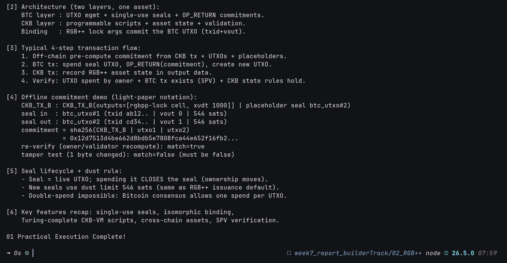

# 🔗 01 - RGB++ Introduction (Isomorphic Binding)

> **Bitcoin UTXOs 1:1 bound to Turing-complete CKB Cells — architecture, 4-step flow, and the commitment scheme proved offline**
> Handbook Advanced (RGB++): `rgbpp.com/docs/introduction`. Offline concept + cryptographic proof; live deployment proof lands in `05_onchain-practice`.

**Module**: Week 7 - RGB++ (02_RGB++)  
**Author**: Riko Kurnia Sandi  
**Official References**: [Introduction](https://rgbpp.com/docs/introduction) | [Isomorphic Binding](https://rgbpp.com/docs/isomorphic-binding) | [Single-Use Seal](https://rgbpp.com/docs/single-use-seal)

---

## 🌟 Executive Summary

RGB++ makes a Bitcoin UTXO a **single-use seal** — a spend-once ownership proof — and binds it one-to-one to a CKB Cell that carries the asset state and Turing-complete validation. CKB acts as public asset database plus off-chain pre-settlement layer. Every RGB++ move is a **transaction pair**: a BTC tx carrying `OP_RETURN(commitment)` and a CKB tx carrying the asset state, where `commitment = hash(CKB_TX | seal_in | seal_out)`.

This module proves the commitment math offline (compute → re-verify → tamper-reject) and maps the 4-step flow, seal lifecycle, and 546-sat dust rule later referenced by the live work in module 05. RGB++ is **not** RGB Protocol v0.11.1 — separate, architecturally unrelated systems.

---

## 📸 Screenshots & Proof of Work



> Save terminal capture as `01_rgbpp-introduction/images/foto-1.png` (run script below, screenshot).

---

## ⚙️ Step-by-Step Practical Execution

1. **What/why**: BTC security × CKB programmability; no bridges, native client verification.
2. **Architecture**: BTC layer (seals + commitments) + CKB layer (scripts + state), synced by RGB++ lock args.
3. **4-step flow**: pre-compute → BTC tx → CKB tx → dual verification (owner spend + SPV existence + CKB rules).
4. **Commitment demo**: `sha256(CKB_TX_B | btc_utxo#1 | btc_utxo#2)` computed, re-verified `match=true`, 1-byte tamper `match=false`.
5. **Seal lifecycle**: live UTXO = open seal; spend = close; new seals at 546-sat dust; double-spend ruled out by Bitcoin consensus.

---

## 💻 Terminal Execution Output (tail)

```text
[4] Offline commitment demo (light-paper notation):
    commitment = sha256(CKB_TX_B | utxo1 | utxo2)
               = 0x12d7513d4be662d8bdb5e7808fca44e652f16fb2...
    re-verify (owner/validator recompute): match=true
    tamper test (1 byte changed): match=false (must be false)

[5] Seal lifecycle + dust rule:
    - Seal = live UTXO; spending it CLOSES the seal (ownership moves).
    - New seals use dust limit 546 sats (same as RGB++ issuance default).

01 Practical Execution Complete!
```

---

## 🚀 Reproduction Guide

```bash
cd "week7_report_builderTrack/02_RGB++"
npm install
node "01_rgbpp-introduction/scripts/rgbpp_intro_demo.js"
```

## 🔗 Next

Continue to [02_light-paper](../02_light-paper/readme.md) for seals, client validation, folding, and the trust-model debate.
