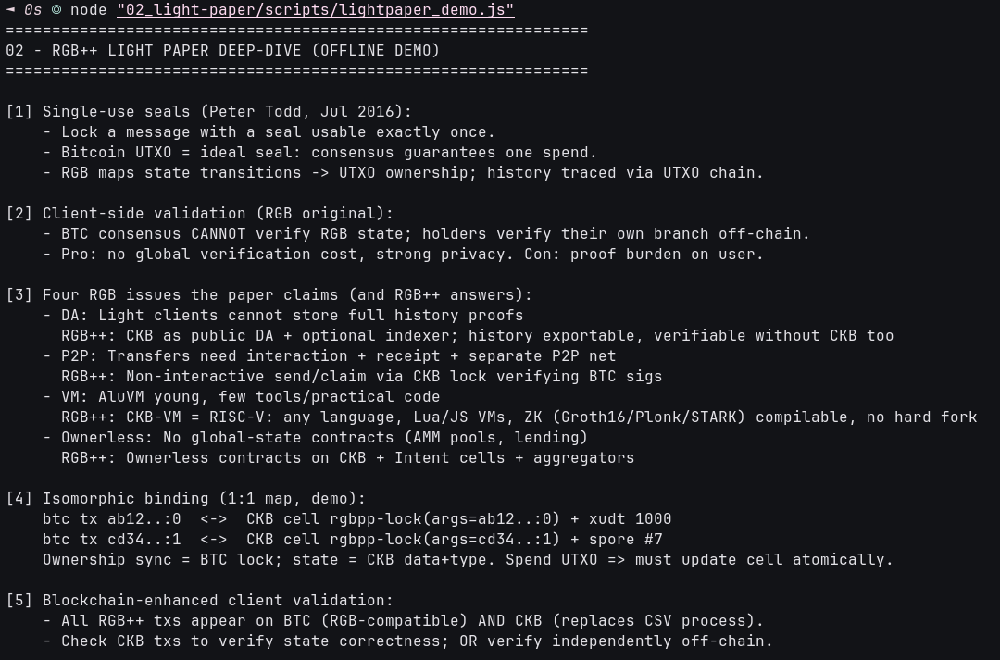

# 📜 02 - RGB++ Light Paper (Seals → Binding → Apps)

> **Single-use seals, client-side validation, the 4 RGB issues, folding, Intent cells, non-interactive transfers, coins/NFTs/Lightning — plus the honest trust-model debate**
> Handbook Advanced (RGB++): [Light Paper translation](https://talk.nervos.org/t/rgb-protocol-light-paper-translation/7790). Offline analysis; every mechanism mapped to executable/report evidence elsewhere in this module.

**Module**: Week 7 - RGB++ (02_RGB++)  
**Author**: Riko Kurnia Sandi  
**Official References**: [Light Paper (EN)](https://talk.nervos.org/t/rgb-protocol-light-paper-translation/7790) | [Light Paper (CN)](https://talk.nervos.org/t/rgb-protocol-light-paper/7733) | [State Validation](https://rgbpp.com/docs/state-validation)

---

## 🌟 Executive Summary

The paper starts from Peter Todd's 2016 single-use seals (Bitcoin UTXO = spend-once seal) and RGB's client-side validation (holders verify their own branch; BTC consensus can't), then lists 4 practical RGB blockers — **DA** (light clients can't hold history proofs), **P2P** (transfers need interaction + receipts + separate net), **VM** (AluVM young), **ownerless contracts** (no global state) — and answers each with CKB: public DA + optional indexing, non-interactive send/claim, RISC-V CKB-VM (any language, ZK compilable, no hard fork), ownerless contracts via Intent cells + aggregators.

Beyond that: blockchain-enhanced validation (CKB txs replace the CSV process, independent off-chain verification still possible), **folding** (N CKB txs → 1 BTC commitment), shared-state contention fixes, xUDT coins (+ bulletproof/ring privacy path), NFTs reusing Spore/CoTA (direct tie to Week 6), Lightning interconnection, and airdrop/DEX sketches. The report closes with the **adambor debate**: pure RGB trusts only self-held history; RGB++ adds CKB as *optional* convenience — txs stay exportable and independently verifiable. Know which mode you verify in.

---

## 📸 Screenshots & Proof of Work



---

## ⚙️ Step-by-Step Practical Execution

1. **Seals + CSV**: UTXO-as-seal mechanics, holder-verified branches.
2. **4-issue matrix**: each RGB problem → RGB++ answer (table in output).
3. **Binding map**: 2 mock UTXO↔cell pairs demonstrating 1:1 ownership-sync/state-split.
4. **Folding math**: 50 CKB txs → 1 BTC tx (~50x BTC load cut).
5. **Intent cells**: front-running fix for global-state contention.
6. **Send/claim**: no-invoice send + BTC-sig-verified CKB claim.
7. **Coins/NFTs/LN/apps**: xUDT issuance shapes, Spore/CoTA reuse, LN channels, SMT airdrop, grid DEX.
8. **Debate**: trust-assumption table, report stance recorded.

---

## 💻 Terminal Execution Output (tail)

```text
[10] Lightning interconnection + apps:
     - RGB++ state channels / LN for RGB++ assets via CKB scripts (stablecoin payments < centralized cost).
     - Airdrop: SMT list + claim-by-address. DEX/AMM: grid orderbook, BTC buys RGB++ xUDT via PBST + CKB tx.

[11] The adambor debate (honest trust model):
     RGB purist: RGB++ adds CKB trust assumption; pure RGB trusts only self-held history.
     RGB++ reply: CKB validation is OPTIONAL enhancement (like Dropbox backup); txs exportable + independently verifiable.
     Report stance: RGB++ = client-validation + optional chain-convenience. Know which mode you verify in.

02 Practical Execution Complete!
```

---

## 🚀 Reproduction Guide

```bash
cd "week7_report_builderTrack/02_RGB++"
node "02_light-paper/scripts/lightpaper_demo.js"
```

## 🔗 Next

Continue to [03_resources-deployments](../03_resources-deployments/readme.md) for scripts, SPV stack, and Meepo deployments.
