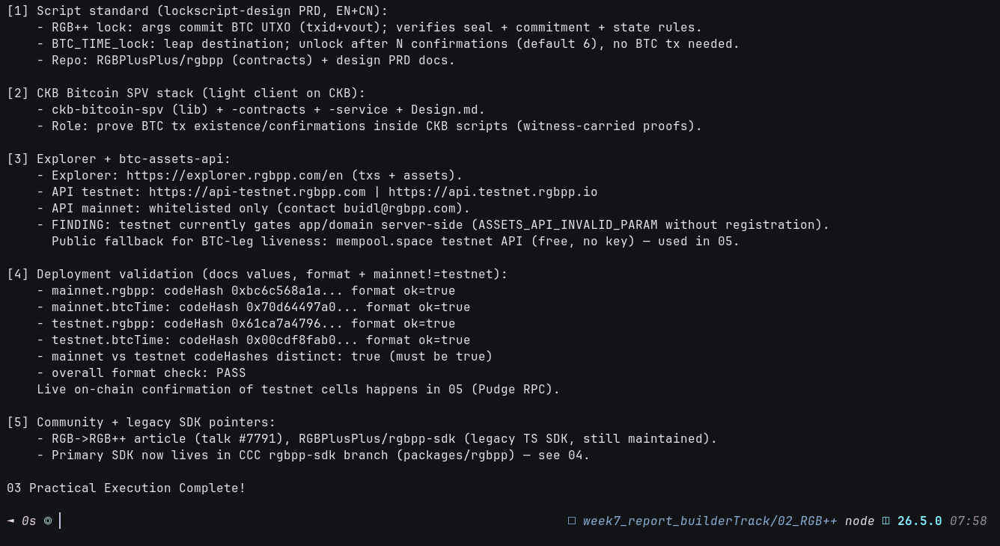

# 🗂️ 03 - RGB++ Resources & Deployments

> **Script standard, SPV stack, explorer, btc-assets-api endpoints + gating finding, and Meepo deployment validation (format offline, existence on-chain in 05)**
> Handbook Advanced (RGB++): [Resources](http://rgbpp.com/docs/resources) (+ components/SPV context). Offline validation here; Pudge existence proof in `05_onchain-practice`.

**Module**: Week 7 - RGB++ (02_RGB++)  
**Author**: Riko Kurnia Sandi  
**Official References**: [Resources](http://rgbpp.com/docs/resources) | [RGB++ Scripts](https://rgbpp.com/docs/components) | [SPV Service](https://rgbpp.com/docs/spv-service) | [Explorer](https://explorer.rgbpp.com/en) | [btc-assets-api](https://github.com/RGBPlusPlus/btc-assets-api)

---

## 🌟 Executive Summary

Resources break into four blocks: **script standard** (RGB++ lock + `BTC_TIME_lock`, EN/CN PRD), **SPV stack** (`ckb-bitcoin-spv` lib/contracts/service — the light client that proves BTC existence inside CKB scripts), **explorer + `btc-assets-api`** (testnet endpoints public; mainnet whitelisted via `buidl@rgbpp.com`), and **Meepo deployments** (mainnet + testnet `code_hash`/`cellDep` tables).

Two honest findings: (1) all four deployment entries pass format checks and mainnet≠testnet; (2) **testnet `btc-assets-api` currently gates `app`/`domain` server-side** (`ASSETS_API_INVALID_PARAM` without registration) — so BTC-leg live queries fall back to free `mempool.space` testnet API in module 05. No key was bought, no gate bypassed.

---

## 📸 Screenshots & Proof of Work



> Save terminal capture as `03_resources-deployments/images/foto-3.png` (run script below, screenshot).

---

## ⚙️ Step-by-Step Practical Execution

1. **Scripts**: RGB++ lock (seal+commitment+state rules) vs `BTC_TIME_lock` (leap target, 6-conf unlock, no BTC tx).
2. **SPV**: lib → contracts → service data flow for witness-carried BTC proofs.
3. **Endpoints**: testnet URLs recorded; whitelist + gating documented, not circumvented.
4. **Deployment table check**: 4 entries format-PASS, mainnet/testnet distinct-PASS.
5. **Pointers**: legacy SDK + community article `#7791` for further reading.

---

## 💻 Terminal Execution Output (tail)

```text
[4] Deployment validation (docs values, format + mainnet!=testnet):
    - mainnet.rgbpp: codeHash 0xbc6c568a1a... format ok=true
    - mainnet.btcTime: codeHash 0x70d64497a0... format ok=true
    - testnet.rgbpp: codeHash 0x61ca7a4796... format ok=true
    - testnet.btcTime: codeHash 0x00cdf8fab0... format ok=true
    - mainnet vs testnet codeHashes distinct: true (must be true)
    - overall format check: PASS
    Live on-chain confirmation of testnet cells happens in 05 (Pudge RPC).

03 Practical Execution Complete!
```

---

## 🚀 Reproduction Guide

```bash
cd "week7_report_builderTrack/02_RGB++"
node "03_resources-deployments/scripts/deployments_demo.js"
```

## 🔗 Next

Continue to [04_ccc-rgbpp-sdk](../04_ccc-rgbpp-sdk/readme.md) for the primary SDK branch surface.
