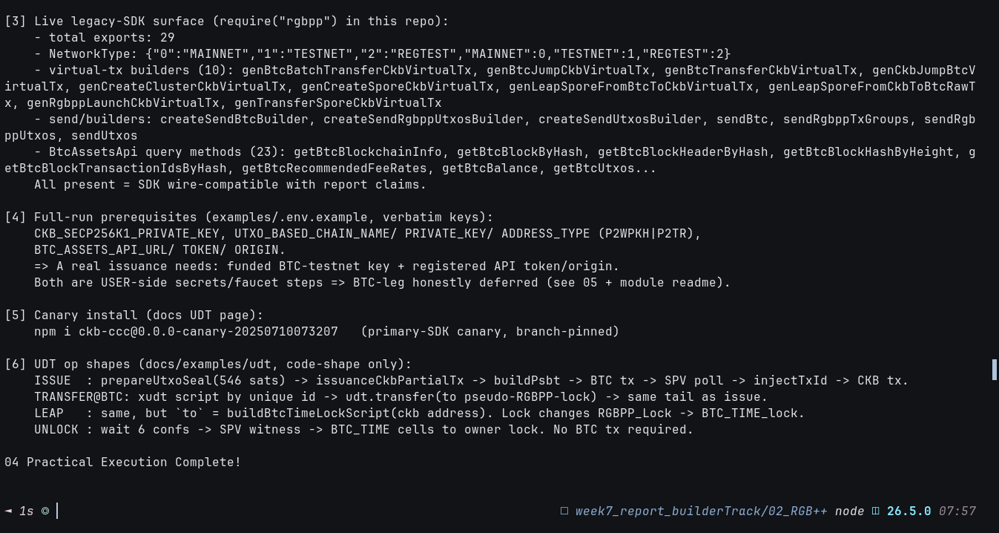

# 🛠️ 04 - CCC RGB++ SDK Branch (Primary SDK)

> **Primary vs legacy SDK, live branch tree, real `rgbpp@0.7.4` import surface, full-run prerequisites, and UDT op shapes — executed offline, no wallet needed**
> Handbook Advanced (RGB++): [ccc branch rgbpp-sdk](https://github.com/ckb-devrel/ccc/tree/rgbpp-sdk) + [UDT example](https://rgbpp.com/docs/examples/udt). Live broadcast variants deferred to 05 (CKB half) with boundaries stated.

**Module**: Week 7 - RGB++ (02_RGB++)  
**Author**: Riko Kurnia Sandi  
**Official References**: [ccc rgbpp-sdk branch](https://github.com/ckb-devrel/ccc/tree/rgbpp-sdk) | [RGB++ SDK docs](https://rgbpp.com/docs/rgbpp-sdk) | [UDT example](https://rgbpp.com/docs/examples/udt) | [Legacy SDK](https://github.com/RGBPlusPlus/rgbpp-sdk)

---

## 🌟 Executive Summary

Two SDKs: **primary** (CCC `rgbpp-sdk` branch, `packages/rgbpp` — 8 modules + 3 example groups, actively developed) vs **legacy** (`RGBPlusPlus/rgbpp-sdk`, maintained; npm `rgbpp@0.7.4` imported live in this demo: 29 exports, virtual-tx builders, `BtcAssetsApi` query surface). The branch's `examples/.env.example` proves a full run needs user-side secrets — CKB key, BTC-testnet key + address type, API URL + **token/origin** — which is exactly why the BTC leg is deferred rather than faked.

UDT ops mapped as code shapes: **issue** (546-sat seal → partial CKB tx → PSBT → BTC tx → SPV poll → injectTxId → CKB tx), **transfer-on-BTC** (xUDT id + pseudo-RGBPP-lock), **leap** (`RGBPP_Lock` → `BTC_TIME_lock`), **unlock** (6 confs + SPV witness, no BTC tx). Canary pin recorded: `ckb-ccc@0.0.0-canary-20250710073207`.

---

## 📸 Screenshots & Proof of Work



> Save terminal capture as `04_ccc-rgbpp-sdk/images/foto-4.png` (run script below, screenshot).

---

## ⚙️ Step-by-Step Practical Execution

1. **Positioning**: primary vs legacy, maintenance status each.
2. **Branch tree**: live GitHub API listing (8 src modules, examples common/spore/udt).
3. **Import surface**: 29 exports asserted at runtime (`NetworkType`, `gen*VirtualTx`, `send*`/`create*`, `BtcAssetsApi` methods).
4. **Prerequisites**: `.env.example` keys quoted verbatim → user-side secret list.
5. **Canary + op shapes**: install pin + 4 UDT flows as shapes.

---

## 💻 Terminal Execution Output (tail)

```text
[3] Live legacy-SDK surface (require("rgbpp") in this repo):
    - total exports: 29
    - NetworkType: {"0":"MAINNET","1":"TESTNET","2":"REGTEST","MAINNET":0,"TESTNET":1,"REGTEST":2}
    - virtual-tx builders (10): genBtcBatchTransferCkbVirtualTx, genBtcJumpCkbVirtualTx, genBtcTransferCkbVirtualTx, genCkbJumpBtcVirtualTx, genCreateClusterCkbVirtualTx, genCreateSporeCkbVirtualTx, genLeapSporeFromBtcToCkbVirtualTx, genLeapSporeFromCkbToBtcRawTx, genRgbppLaunchCkbVirtualTx, genTransferSporeCkbVirtualTx
    - send/builders: createSendBtcBuilder, createSendRgbppUtxosBuilder, createSendUtxosBuilder, sendBtc, sendRgbppTxGroups, sendRgbppUtxos, sendUtxos
    - BtcAssetsApi query methods (23): getBtcBlockchainInfo, getBtcBlockByHash, ...

[6] UDT op shapes (docs/examples/udt, code-shape only):
    ISSUE  : prepareUtxoSeal(546 sats) -> issuanceCkbPartialTx -> buildPsbt -> BTC tx -> SPV poll -> injectTxId -> CKB tx.
    LEAP   : same, but `to` = buildBtcTimeLockScript(ckb address). Lock changes RGBPP_Lock -> BTC_TIME_lock.
    UNLOCK : wait 6 confs -> SPV witness -> BTC_TIME cells to owner lock. No BTC tx required.

04 Practical Execution Complete!
```

---

## 🚀 Reproduction Guide

```bash
cd "week7_report_builderTrack/02_RGB++"
npm install
node "04_ccc-rgbpp-sdk/scripts/ccc_rgbpp_demo.js"
```

## 🔗 Next

Continue to [05_onchain-practice](../05_onchain-practice/readme.md) for live Pudge verification + CKB-side coin issuance.
