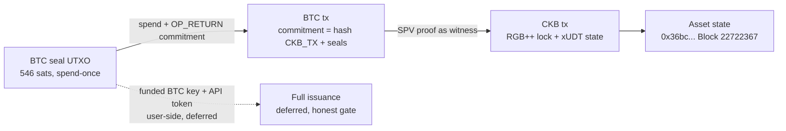

# 🟧 02 - RGB++ Protocol (Bitcoin's Turing Catalyst)

**Module**: Week 7 - RGB++ (Handbook Advanced: RGB++ Protocol)  
**Author**: Riko Kurnia Sandi  
**Date**: October 2026  
**Sources**: [Introduction](https://rgbpp.com/docs/introduction) | [Light Paper](https://talk.nervos.org/t/rgb-protocol-light-paper-translation/7790) | [Resources](http://rgbpp.com/docs/resources) | [ccc rgbpp-sdk branch](https://github.com/ckb-devrel/ccc/tree/rgbpp-sdk)

---

## 🌟 Module Summary

This module completes the Handbook **RGB++** block: Bitcoin UTXOs as single-use seals bound 1:1 to Turing-complete CKB Cells (isomorphic binding), with CKB as public asset database and pre-settlement layer. Coverage runs concept → paper → deployments → SDK → live proof:

1. **Introduction** — architecture, 4-step flow, commitment scheme proved offline (compute → re-verify → tamper-reject).
2. **Light paper** — seals, client-side validation, 4 RGB issues + answers, folding, Intent cells, non-interactive send/claim, coins/NFTs/Lightning, and the honest RGB-vs-RGB++ trust debate.
3. **Resources & deployments** — script standard, SPV stack, explorer, API endpoints + gating finding, Meepo deployment validation.
4. **CCC RGB++ SDK** — primary vs legacy, live branch tree + `rgbpp@0.7.4` import surface, full-run prerequisites, UDT op shapes.
5. **On-chain practice** — both Meepo-testnet deployments hash-verified on Pudge + a real 21M-unit xUDT issuance (the CKB asset-state half of an RGB++ coin).

The BTC seal leg (funded BTC-testnet key + registered API token) is user-side and honestly deferred — documented, not faked.

---

## 📊 Verification Matrix

| Sub-module | Topic | Deliverable | Status |
| :--- | :--- | :--- | :--- |
| [01_rgbpp-introduction](./01_rgbpp-introduction/readme.md) | Intro + commitment scheme | [`rgbpp_intro_demo.js`](./01_rgbpp-introduction/scripts/rgbpp_intro_demo.js) (commitment `0x12d7…`, tamper-reject) | 🟢 Off-chain verified |
| [02_light-paper](./02_light-paper/readme.md) | Seals → binding → apps + debate | [`lightpaper_demo.js`](./02_light-paper/scripts/lightpaper_demo.js) (folding math, trust stance) | 🟢 Off-chain verified |
| [03_resources-deployments](./03_resources-deployments/readme.md) | Scripts, SPV, endpoints, deployments | [`deployments_demo.js`](./03_resources-deployments/scripts/deployments_demo.js) (4/4 format PASS) | 🟢 Off-chain verified |
| [04_ccc-rgbpp-sdk](./04_ccc-rgbpp-sdk/readme.md) | Primary SDK branch surface | [`ccc_rgbpp_demo.js`](./04_ccc-rgbpp-sdk/scripts/ccc_rgbpp_demo.js) (29 exports, 10 builders, 23 API methods) | 🟢 Off-chain verified |
| [05_onchain-practice](./05_onchain-practice/readme.md) | Live deployments + CKB-side coin | Tx [`0xf1de59e9…`](https://pudge.explorer.nervos.org/transaction/0xf1de59e973b85791ec32debbba08dff80c63197e895eb95d67fc1e9f6b413e00) / [`0xde0f8787…`](https://pudge.explorer.nervos.org/transaction/0xde0f87878a97500f549418e5d46d2f7704c565a262aa17036c9c1c13ad638529) / [`0x36bc583f…`](https://pudge.explorer.nervos.org/transaction/0x36bc583f34bc903d2e736a7a7f856606373185f5d3e48bec894eb2ac875a4997) | 🟢 All committed + hash MATCH |

---

## 🏗️ RGB++ Transaction Pair (this module)



---

## 1️⃣ 01 - RGB++ Introduction

> 📂 **Sub-Report**: [👉 01_rgbpp-introduction](./01_rgbpp-introduction/readme.md)

- Seal = live UTXO; `commitment = sha256(CKB_TX_B | utxo#1 | utxo#2)` (`0x12d7…`, tamper-reject proven); 546-sat dust; RGB++ ≠ RGB v0.11.1.

### Execution Proof:

> Save terminal capture as `01_rgbpp-introduction/images/foto-1.png`.

---

## 2️⃣ 02 - Light Paper

> 📂 **Sub-Report**: [👉 02_light-paper](./02_light-paper/readme.md)

- Seals (Todd 2016), CSV, 4 RGB issues → CKB answers, 50x folding math, Intent cells, send/claim, xUDT + Spore/CoTA + LN, adambor debate stance.

### Execution Proof:

> Save terminal capture as `02_light-paper/images/foto-2.png`.

---

## 3️⃣ 03 - Resources & Deployments

> 📂 **Sub-Report**: [👉 03_resources-deployments](./03_resources-deployments/readme.md)

- Lock + `BTC_TIME_lock` roles, SPV lib/contracts/service, explorer, testnet API gating finding, 4/4 deployment format PASS.

### Execution Proof:

> Save terminal capture as `03_resources-deployments/images/foto-3.png`.

---

## 4️⃣ 04 - CCC RGB++ SDK

> 📂 **Sub-Report**: [👉 04_ccc-rgbpp-sdk](./04_ccc-rgbpp-sdk/readme.md)

- Primary (CCC branch, 8 modules) vs legacy (`rgbpp@0.7.4`: 29 exports); `.env.example` secrets list; canary pin; 4 UDT op shapes.

### Execution Proof:

> Save terminal capture as `04_ccc-rgbpp-sdk/images/foto-4.png`.

---

## 5️⃣ 05 - On-Chain Practice

> 📂 **Sub-Report**: [👉 05_onchain-practice](./05_onchain-practice/readme.md)

- **RGB++ lock**: [`0xf1de59e9…`](https://pudge.explorer.nervos.org/transaction/0xf1de59e973b85791ec32debbba08dff80c63197e895eb95d67fc1e9f6b413e00) `#12,720,748`, type-hash MATCH `0x61ca…`.
- **BTC_TIME_lock**: [`0xde0f8787…`](https://pudge.explorer.nervos.org/transaction/0xde0f87878a97500f549418e5d46d2f7704c565a262aa17036c9c1c13ad638529) `#12,720,729`, MATCH `0x00cd…`.
- **xUDT coin**: [`0x36bc583f…`](https://pudge.explorer.nervos.org/transaction/0x36bc583f34bc903d2e736a7a7f856606373185f5d3e48bec894eb2ac875a4997) `#22,722,367`, 21M units.
- BTC liveness via mempool.space (free); `btc-assets-api` gated → boundary.

### Execution Proof:

> Save terminal capture as `05_onchain-practice/images/foto-5.png` (verify output).

---

## 🛡️ Evidence Boundaries (honest scope, like Week 3)

| Capability | Current evidence |
|---|---|
| Commitment scheme | Offline compute → re-verify → tamper-reject |
| Light-paper mechanics | Concept matrix + folding math + recorded debate stance (no chain claims) |
| Deployment values | Docs format PASS + Pudge existence + local type-hash recompute MATCH |
| SDK surface | Runtime export inventory from installed packages + live branch tree |
| CKB-side coin | Real Pudge tx `0x36bc…` with owner-lock-hash args + u128 LE amount |
| BTC seal + SPV + full issuance | Deferred — needs funded BTC-testnet key + registered API token/origin |
| `btc-assets-api` reads | Gated server-side even on testnet; attempted twice, documented |
| Mainnet | None — testnet only |

`network: ckb_testnet` + Pudge explorer links are the only settlement evidence. Balances in logs are informational (indexer-lagged), not proof.

---

## 📂 Project Structure & Navigation

```text
02_RGB++/
├── readme.md (Module Report - You are here)
├── package.json (@ckb-ccc/core + rgbpp, isolated from week7 root)
├── images/
├── 01_rgbpp-introduction/
│   ├── readme.md
│   ├── scripts/rgbpp_intro_demo.js
│   └── images/foto-1.png (user screenshot)
├── 02_light-paper/
│   ├── readme.md
│   ├── scripts/lightpaper_demo.js
│   └── images/foto-2.png (user screenshot)
├── 03_resources-deployments/
│   ├── readme.md
│   ├── scripts/deployments_demo.js
│   └── images/foto-3.png (user screenshot)
├── 04_ccc-rgbpp-sdk/
│   ├── readme.md
│   ├── scripts/ccc_rgbpp_demo.js
│   └── images/foto-4.png (user screenshot)
└── 05_onchain-practice/
    ├── readme.md
    ├── scripts/rgbpp_coin_demo.mjs (live, spends)
    ├── scripts/rgbpp_verify.js (read-only, screenshot this)
    └── images/foto-5.png (user screenshot)
```

---

## 🚀 Verification Commands

```bash
cd "week7_report_builderTrack/02_RGB++"
npm install
node "01_rgbpp-introduction/scripts/rgbpp_intro_demo.js"
node "02_light-paper/scripts/lightpaper_demo.js"
node "03_resources-deployments/scripts/deployments_demo.js"
node "04_ccc-rgbpp-sdk/scripts/ccc_rgbpp_demo.js"
node "05_onchain-practice/scripts/rgbpp_verify.js"
# Live re-mint only for NEW xUDT types (spends testnet CKB):
# node "05_onchain-practice/scripts/rgbpp_coin_demo.mjs"
```

---

## 🎯 Next Module

With RGB++ concept → deployments → SDK → live CKB half complete, remaining work is user-side (fund BTC-testnet key, register API `app`/`domain`, run issue/transfer/leap/unlock end-to-end). Handbook Advanced continues with **xUDT deep-dive** and **iCKB**; SSRI (`01_SSRI`) ships in parallel.
