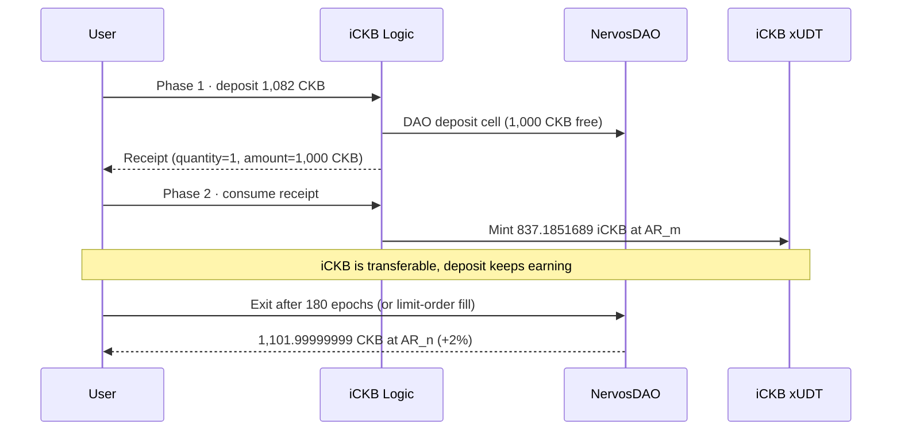

# 🌊 01 - iCKB Whitepaper: Liquid NervosDAO Deposits

> **Offline model of the whole lifecycle: receipt, two-phase mint, 180-epoch exit, and the oversized-deposit fee — all re-derived from the whitepaper math**
> No network, no spend. The exchange ratio is a labelled testnet snapshot, so every number below is reproducible.

**Module**: Week 8 - iCKB (ickb)
**Author**: Riko Kurnia Sandi
**Official References**: [iCKB whitepaper](https://github.com/ickb/whitepaper) | [ickb.org](https://ickb.org) | [Nervos KB: iCKB](https://www.nervos.org/knowledge-base/ickb)

---

## 🌟 Executive Summary

iCKB turns a NervosDAO deposit into a transferable xUDT. The deposit still earns DAO compensation; the receipt is what makes it liquid.

The model reproduces four things a reader needs to trust the rest of the module:

1. **Exchange rate** — `1 iCKB = AR_m / AR_0` CKB. At the snapshot, `1 iCKB = 1.19447887 CKB`.
2. **Minimum deposit** — `1,000 CKB` free + `82 CKB` occupied = **`1,082 CKB` total**, minting `837.1851689 iCKB`.
3. **Exit** — a 180-epoch DAO claim at a higher AR returns `1,101.99999999 CKB` on a simulated +2% AR, i.e. `+19.99999999 CKB`.
4. **Large deposits** — above `100,000 iCKB` the protocol charges **10% on the excess only**; `150,000 CKB` free nets `123,019.99780254 iCKB`.

All six invariants pass, including the same-rate round trip (1-shannon integer rounding).

---

## 🧠 The Mechanism in One Table

| Piece | What it is | Why it exists |
| :--- | :--- | :--- |
| **NervosDAO deposit** | `1,000+ CKB` locked under the DAO type script | Earns secondary-issuance compensation |
| **Receipt** | Cell typed by iCKB Logic, data = `quantity + deposit_amount` | Proves the deposit without moving it |
| **iCKB** | xUDT whose args commit to the iCKB Logic script | Transferable claim on the deposit |
| **Phase 1** | Deposit CKB, emit receipt | Locks principal in the DAO |
| **Phase 2** | Consume receipt, mint iCKB at `AR_0 / AR_m` | Makes the claim liquid |
| **Exit** | DAO claim after 180 epochs, or a limit-order fill | Returns CKB + compensation |
| **Limit order** | Order book for CKB ↔ iCKB | Avoids waiting 180 epochs |

The receipt is the hinge: it is a separate cell, so phase 1 and phase 2 are separate transactions. That is why the live module (`05`) needs two transactions, not one.

---

## 🧮 The Math

```text
exchange rate       1 iCKB = AR_m / AR_0 CKB
mint                iCKB  = deposit_amount * AR_0 / AR_m
DAO claim           CKB   = (c_t - c_o) * AR_n / AR_m + c_o
large deposit fee   10% of (gross_iCKB - 100,000 iCKB)
```

- `AR_0 = 10,000,000,000,000,000` (genesis)
- `AR_m` is the accumulated rate at the deposit header
- `AR_n` is the accumulated rate at withdrawal
- `c_o = 82 CKB` occupied, `c_t` is the deposit capacity

The fee is deliberately only on the excess: a deposit just under the standard size pays nothing, while a whale cannot split a huge deposit into free standard-size chunks without paying for the privilege.

---

## 🔄 Lifecycle



---

## 💻 Terminal Execution Output

```text
=== 01 · iCKB Whitepaper Mechanics ===
Model: offline. Exchange ratio is a labelled testnet snapshot.
Snapshot tip: #22803925, AR_m = 11944788765246529

1. Genesis parameters
  AR_0 (genesis)           : 10000000000000000
  Standard deposit         : 100,000 iCKB
  Occupied capacity        : 82 CKB
  Free CKB range           : 1000 .. 1000000 CKB
  Min total capacity       : 1082 CKB

2. Exchange rate at the snapshot
  1 iCKB = 1.19447887 CKB
  1 CKB  = 0.83718516 iCKB
  AR grows with DAO secondary issuance, so 1 iCKB is worth more CKB over time.

3. Deposit -> receipt -> iCKB (phase 1 + phase 2)
  Input capacity           : 1082 CKB
  Free capacity (deposit)  : 1000 CKB
  Receipt data             : quantity=1, deposit_amount=100000000000
  Phase 2 gross iCKB       : 837.1851689 iCKB
  Phase 2 fee              : 0 iCKB
  Phase 2 minted iCKB      : 837.1851689 iCKB

4. Withdrawal after 180 epochs (simulated AR +2%)
  AR_n                     : 12183684540551459 (+2%)
  DAO claim formula        : (c_t - c_o) * AR_n / AR_m + c_o
  Free CKB returned        : 1019.99999999 CKB
  Total capacity returned  : 1101.99999999 CKB
  Profit                   : 19.99999999 CKB

5. Oversized deposit (fee on the portion above 100,000 iCKB)
  Free capacity            : 150000 CKB
  Gross iCKB               : 125577.77533615 iCKB
  Above standard           : 25577.77533615 iCKB
  10% fee                  : 2557.77753361 iCKB
  Net iCKB                 : 123019.99780254 iCKB

6. Invariants
  [PASS] exchange rate is above 1 CKB per iCKB — 1 iCKB = 1.19447887 CKB
  [PASS] minimum deposit is 1,082 CKB total — 1000 free + 82 occupied
  [PASS] same-rate round trip returns the input capacity — diff 1 shannon(s)
  [PASS] oversized deposit pays the 10% fee only above the cap — fee 2557.77753361 iCKB
  [PASS] withdrawal at a higher AR returns more CKB — +19.99999999 CKB over 180 epochs
  [PASS] receipt amount is the free capacity, not the total capacity — 1000 CKB

Summary: 6/6 checks passed.
```

---

## 📸 Screenshot


---

## 🚀 Reproduction Guide

```bash
cd "week8_report_builderTrack/ickb"
node "01_whitepaper/scripts/ickb_whitepaper_demo.js"
```

Offline, deterministic, no key. Change `AR_M` in the script to test another snapshot; the invariants and the fee logic stay the same.

---

## 🛡️ Evidence Boundaries

| Capability | Current evidence |
|---|---|
| Exchange-rate math | Re-derived from the whitepaper; matches the live SDK ratio in `04` |
| Minimum deposit | `1,082 CKB` total, `1,000 CKB` free — matches the live deposit builder |
| Oversized-deposit fee | Modeled exactly (10% above `100,000 iCKB`) |
| 180-epoch exit | Modeled with a simulated +2% AR, not waited out |
| Live deposit / mint | Deferred to `05_deep-dive` (needs ACC and ~1,300 CKB) |
| Mainnet | None — testnet snapshot only |

---

## 🔗 Next

`02_github-repository` maps the code that implements this model; `04_ickb-sdk` proves the same ratio against the live testnet deployment.
