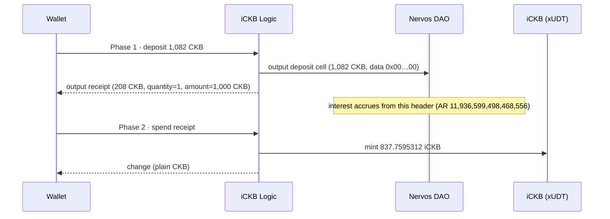

# 🧪 05 - Deep Dive: A Live iCKB Deposit, End to End

> **1,082 CKB deposited, 1,000 CKB free capacity committed to the DAO, 837.7595312 iCKB minted — two real transactions, verified from the chain**
> Testnet only. Two signed transactions. No withdrawal.

**Module**: Week 8 - iCKB (ickb)
**Author**: Riko Kurnia Sandi
**Official References**: [iCKB docs](https://docs.ickb.org) | [stack SDK](https://github.com/ickb/stack/tree/master/sdk) | [Nervos DAO](https://docs.nervos.org/docs/basics/economics#nervos-dao)

---

## 🌟 Executive Summary

This is the spend that the other four sub-reports point to. It uses the vendored SDK builders, signs with the builder testnet key, and proves the result by reading the chain back.

| Step | Transaction | Block | Result |
| :--- | :--- | :--- | :--- |
| Phase 1 | [`0x631c8b4a…`](https://pudge.explorer.nervos.org/transaction/0x631c8b4ae65aa456006472e526b89c0047869e8e40fdbfa331d8621dd6d05371) | `#22,804,094` | DAO deposit `1,082 CKB` + receipt `208 CKB` |
| Phase 2 | [`0x4dd5c139…`](https://pudge.explorer.nervos.org/transaction/0x4dd5c139ade7638a6bac605e64b652a512fc8b9188c9fa3d5e5d9762d41aa08e) | `#22,804,097` | receipt consumed, `837.7595312 iCKB` minted |

The receipt encodes `depositAmount = 1,000 CKB` (free capacity) and `quantity = 1`. Its header AR is `11,936,599,498,468,556`, so the mint is `1,000 × 10¹⁶ / AR = 837.7595312 iCKB`. The read-only verifier re-derives that number from the chain and passes **17/17** checks.

---

## 🧠 Why Two Transactions

iCKB is a receipt-based deposit. Phase 1 puts CKB into a Nervos DAO cell and mints a receipt that records the deposit at that header. Phase 2 burns the receipt and mints the iCKB. Splitting the phases lets a wallet hold a receipt without holding iCKB, and it lets the DAO interest accrue on the deposit cell from the phase-1 header.



Both phases are built by `IckbSdk` and completed by `completeTransaction`, which also adds the iCKB change and the plain fee change.

### The public path is not this path

`buildConversionTransaction({ direction: "ckb-to-ickb", amount })` is the product path. Below the `100,000 iCKB` deposit cap it plans a **limit order**, because the protocol wants small conversions to meet the order book. A direct deposit uses the documented internals:

```js
let tx = config.ickbLogic.deposit({}, 1, ccc.fixedPointFrom(1082), lock);
tx = await sdk.completeTransaction(tx, { signer, lock, feeRate, cells });

// after phase 1 confirms
let tx2 = sdk.buildBaseTransaction({}, { availableOrders: [], receipts: [receipt], readyWithdrawals: [] });
tx2 = await sdk.completeTransaction(tx2, { signer, lock, feeRate, cells });
```

`deposit(...)` takes the **total** cell capacity. The cell keeps 82 CKB occupied, so `1,082 CKB` total gives exactly `1,000 CKB` free.

---

## 💻 Terminal Execution Output

```text
RPC        : https://testnet.ckb.dev/rpc
Wallet     : ckt1qzda0cr08m85hc8jlnfp3zer7xulejywt49kt2rr0vthywaa50xwsqwy0rpn3trq0sj2q6arv7xaq9w6m6xa0egxe8xvr
Deposit    : 1082 CKB
Mode       : live

1. Account state before deposit
  tip          : #22804091
  balance      : 76399.99916838 CKB in 2 cell(s)
  receipts     : 0 (0 iCKB)
  1 iCKB       : 1.19447993 CKB
  fee rate     : 33222 shannons/KB

2. Phase 1 transaction (CKB -> DAO deposit + iCKB receipt)
  inputs       : 2
  outputs      : 3
  deposit out  : #0 1082 CKB (lock = iCKB Logic, type = Nervos DAO)
  receipt out  : #1 208 CKB (type = iCKB Logic)
  sent         : 0x631c8b4ae65aa456006472e526b89c0047869e8e40fdbfa331d8621dd6d05371
  committed    : block #22804094

3. Account state after phase 1
  receipt      : 0x631c8b4ae65aa456006472e526b89c0047869e8e40fdbfa331d8621dd6d05371:1
  deposit      : 208 CKB -> 837.7595312 iCKB at header AR 11936599498468556
  receipt data : quantity 1, deposit 1000 CKB

4. Phase 2 transaction (iCKB receipt -> iCKB)
  inputs       : 2 (includes the receipt)
  outputs      : 2
  iCKB out     : #0 837.7595312 iCKB at 146 CKB

  sent         : 0x4dd5c139ade7638a6bac605e64b652a512fc8b9188c9fa3d5e5d9762d41aa08e
  committed    : block #22804097

5. Account state after phase 2
  iCKB cells   : 1
  iCKB balance : 837.7595312 iCKB
  receipts     : 0

Evidence written to .../05_deep-dive/deposit.json
```

> The `deposit: 208 CKB` line in step 3 is the receipt cell's capacity. The mint is computed from the `1,000 CKB` free amount inside the receipt data, which the next line prints.

### Independent verification

```text
1. Phase 1 transaction and its outputs
  [PASS] phase 1 is committed — block #22804094
  [PASS] deposit output is an iCKB Logic-locked DAO cell — 1082 CKB
  [PASS] deposit data is the empty DAO payload
  [PASS] receipt output carries the iCKB Logic type — 208 CKB
  [PASS] receipt decodes to one deposit of the recorded amount — quantity 1, deposit 1000 CKB free
  [PASS] receipt header matches the phase 1 commit header — AR 11936599498468556

2. Deposit and receipt cell status now
  [PASS] deposit cell is live and still locked by iCKB Logic — 1082 CKB
  [PASS] receipt cell was consumed by phase 2

3. Phase 2 transaction and the minted iCKB
  [PASS] phase 2 is committed — block #22804097
  [PASS] phase 2 spends the receipt
  [PASS] phase 2 output is iCKB — 837.7595312 iCKB
  [PASS] minted amount matches the recorded evidence — 837.7595312 iCKB
  [PASS] mint equals depositAmount * 1e16 / header AR — 837.7595312 vs 837.7595312 (delta 0)
  [PASS] iCKB cell is live

4. iCKB type script commits to the deployed Logic code
  [PASS] deployed Logic cell data hashes to its code hash — 0x2a8100ab5990fa055ab1b50891702e1e895c7bd1df6322cd725c1a6115873bd3
  [PASS] type args start with the live Logic script hash — 0xb73b6ab39d79390c6de90a09c96b290c331baf1798ed6f97aed02590929734e800000080
  [PASS] type args end with owner mode 0x80000000

5. Current account view
  wallet CKB  : 73158.9986039 in 1 cell(s)
  iCKB balance: 837.7595312

17/17 checks passed
```

---

## 📸 Screenshot


---

## 🚀 Reproduction Guide

Build first without spending, then run the live pair, then verify:

```bash
cd "week8_report_builderTrack/ickb"
npm install

# 1. Build and complete phase 1 · no signature, no broadcast
node "05_deep-dive/scripts/ickb_live_deposit.mjs" --dry-run

# 2. Live: phase 1 + phase 2 (spends ~1,291 CKB + fees)
node "05_deep-dive/scripts/ickb_live_deposit.mjs"

# 3. Read-only: re-derive every claim from the chain
npm run verify
```

`deposit.json` is written by the live run and read by the verifier. Re-running the live step creates a **new** deposit and overwrites the file; the two transactions above stay immutable.

---

## 🛡️ Evidence Boundaries

| Capability | Current evidence |
|---|---|
| Direct CKB → iCKB deposit | Real tx `0x631c…` (committed); deposit cell live |
| Receipt → iCKB mint | Real tx `0x4dd5…` (committed); receipt consumed |
| Mint arithmetic | Recomputed from receipt `1,000 CKB` and header AR, delta `0` |
| Type-script binding | Args = live Logic script hash + owner mode |
| Interest accrual | Deposit cell is a standard DAO deposit; not withdrawn |
| Withdrawal (180 epochs) | **Not exercised** — would lock the report for ~30 days |
| Order book / instant exit | **Not exercised** in this sub-report; read in `04` |
| Mainnet | Not exercised — testnet only |
| Key | Builder testnet key, already public in the repo's earlier weeks |
| Shared wallet | Balance drifted during the session (another process uses the same key); the two tx hashes are unaffected |

---

## 🔗 Next

This closes the five sub-reports. The remaining honest gap is the **withdrawal cycle**: iCKB → receipt → DAO withdrawal request → 180 epochs → CKB. It is documented in `01` and its maturity math is reproduced there, but it is not executed here.
