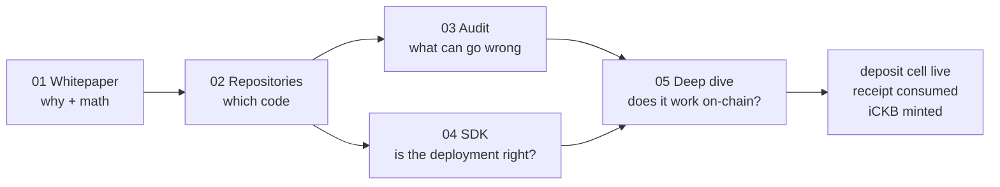

# 🌊 Week 8 Builder Track Master Report: iCKB

**Name Builder**: Riko Kurnia Sandi
**Date**: 20 October 2026
**Track**: CKB Builder Track (Phase 3: Advanced — iCKB)

---

## 🌟 Executive Summary

iCKB turns a Nervos DAO deposit into a liquid, transferable token. The deposit still earns DAO interest; the receipt and the iCKB token make it usable before the 180-epoch unlock. This module follows the idea from paper to deployed code, audits it, reads the current SDK, and then **spends real testnet CKB** to prove the two-phase mint.

Five sub-reports, one chain of evidence:

1. **Whitepaper** — the lifecycle re-derived offline: `1,082 CKB` → `1,000 CKB` free → `837.1851689 iCKB` at the snapshot ratio, exit after 180 epochs, oversized-deposit fee.
2. **Repositories** — three maintained repos (`whitepaper`, `contracts`, `stack`) pinned to real commits, five script hashes checked against `constants.ts`.
3. **Audit** — ScaleBit 2024 (3 findings, 0 medium+) and the 2026 executable review of the same commit: **LO-01 is still live** (limit-order confusion can strand orders; no principal theft).
4. **SDK** — `ickb/stack/sdk` vendored at `9582ab4`, reading testnet: code hashes MATCH, 8-member dep group, iCKB type args, pool and order book.
5. **Deep dive** — a real deposit and a real mint: [`0x631c8b4a…`](https://pudge.explorer.nervos.org/transaction/0x631c8b4ae65aa456006472e526b89c0047869e8e40fdbfa331d8621dd6d05371) and [`0x4dd5c139…`](https://pudge.explorer.nervos.org/transaction/0x4dd5c139ade7638a6bac605e64b652a512fc8b9188c9fa3d5e5d9762d41aa08e), **17/17** independent checks.

The live pair is the anchor: `1,082 CKB` deposit cell (still live), receipt consumed, **`837.7595312 iCKB`** minted at header AR `11,936,599,498,468,556`.

---

## 📊 Curriculum & Verification Synthesis

| Sub-Report | Domain / Topic | Core Technical Primitive | Verification Deliverable |
| :--- | :--- | :--- | :--- |
| [**01_whitepaper**](./01_whitepaper/readme.md) | Liquidity design | Receipt, two-phase mint, 180-epoch exit, deposit cap | [`ickb_whitepaper_demo.js`](./01_whitepaper/scripts/ickb_whitepaper_demo.js) — 6/6 offline |
| [**02_github-repository**](./02_github-repository/readme.md) | Source of truth | Three repos, pinned heads, script hashes | [`ickb_repo_demo.js`](./02_github-repository/scripts/ickb_repo_demo.js) — 6/6 |
| [**03_audit-report**](./03_audit-report/readme.md) | Security | ScaleBit 2024 + 2026 review, LO-01 | [`ickb_audit_demo.js`](./03_audit-report/scripts/ickb_audit_demo.js) — 8/8 |
| [**04_ickb-sdk**](./04_ickb-sdk/readme.md) | Live deployment | Code hashes, dep group, type args, pool, ratio | [`ickb_sdk_demo.mjs`](./04_ickb-sdk/scripts/ickb_sdk_demo.mjs) — 8/8 live read |
| [**05_deep-dive**](./05_deep-dive/readme.md) | Live spend | Phase 1 deposit + receipt, phase 2 mint | [`ickb_live_deposit.mjs`](./05_deep-dive/scripts/ickb_live_deposit.mjs) + [`ickb_verify.js`](./05_deep-dive/scripts/ickb_verify.js) — 17/17 |

### Live transactions

| Step | Tx | Block | What it proves |
| :--- | :--- | :--- | :--- |
| Phase 1 | [`0x631c8b4ae65aa456006472e526b89c0047869e8e40fdbfa331d8621dd6d05371`](https://pudge.explorer.nervos.org/transaction/0x631c8b4ae65aa456006472e526b89c0047869e8e40fdbfa331d8621dd6d05371) | `#22,804,094` | `1,082 CKB` DAO cell + `208 CKB` receipt (`quantity=1`, `deposit=1,000 CKB`) |
| Phase 2 | [`0x4dd5c139ade7638a6bac605e64b652a512fc8b9188c9fa3d5e5d9762d41aa08e`](https://pudge.explorer.nervos.org/transaction/0x4dd5c139ade7638a6bac605e64b652a512fc8b9188c9fa3d5e5d9762d41aa08e) | `#22,804,097` | receipt consumed, `837.7595312 iCKB` minted |

---

## 🔗 How the Five Fit Together



- **01 → 05**: the whitepaper's `ckbValue × 10¹⁶ / AR` formula is exactly what the verifier recomputes; delta `0`.
- **02 → 04**: the pinned hashes in `02` are the ones `04` finds in live cell data.
- **03 → 05**: the audit's LO-01 is why `05` uses a **direct deposit**, not the order book; the order path is read in `04`, not exercised.
- **04 → 05**: the same vendored SDK builds both live transactions; no separate client.

---

## 🛡️ Evidence Boundaries (honest scope)

| Capability | Current evidence |
|---|---|
| Whitepaper lifecycle math | Offline model, 6/6, including 180-epoch maturity and the 2% oversize fee |
| Repository state | Heads pinned: whitepaper `3e0ffbd`, contracts `c951927`, stack `9582ab4` |
| Audit | Two reports read in full; 2024 PDF and 2026 markdown vendored with SHA-256 |
| Deployed identity | xUDT `0x50bd…` and Logic `0x2a81…` MATCH live cell data; 8-member dep group |
| SDK read | Testnet pool `380` deposits (`10` ready), `19` orders, ratio `1.1944796` |
| Direct deposit + mint | **Real**, two committed txs, 17/17 verifier checks |
| Withdrawal after 180 epochs | **Not exercised** — would lock funds for ~30 days; math covered in `01` |
| Order book / instant exit | **Read only** in `04`; not traded |
| Mainnet | Not exercised — testnet only |
| Legacy `@ickb/sdk@1000.x` | Intentionally not used |

---

## 📂 Project Structure & Navigation

```text
week8_report_builderTrack/ickb/
├── package.json                  # ESM, @ckb-ccc/core 1.23.0, scripts 01–04 + verify
├── readme.md                     # Master report (you are here)
├── lib/
│   ├── ickb-sdk/                 # vendored stack/sdk/src @ 9582ab4 + LICENSE + PROVENANCE
│   └── ...
├── 01_whitepaper/                readme + scripts/ickb_whitepaper_demo.js + images/foto-1.png
├── 02_github-repository/         readme + scripts/ickb_repo_demo.js + images/foto-2.png
├── 03_audit-report/              readme + scripts/ickb_audit_demo.js + evidence/*.pdf,*.md + images/foto-3.png
├── 04_ickb-sdk/                  readme + scripts/ickb_sdk_demo.mjs + images/foto-4.png
└── 05_deep-dive/                 readme + scripts/ickb_live_deposit.mjs + scripts/ickb_verify.js
                                  + deposit.json + images/foto-1.png
```

The SDK is vendored because the rewritten line is not on npm. `PROVENANCE.md` records the commit and the MIT license.

---

## 🚀 Verification Commands

```bash
cd "week8_report_builderTrack/ickb"
npm install

# Offline / repository / audit
npm run 01
npm run 02
npm run 03

# Live read-only (deployment, pool, ratio)
npm run 04

# Live deposit pair — build first, then spend, then verify
node "05_deep-dive/scripts/ickb_live_deposit.mjs" --dry-run
node "05_deep-dive/scripts/ickb_live_deposit.mjs"
npm run verify
```

`01`–`04` are safe to re-run. The live deposit spends CKB and writes a new `05_deep-dive/deposit.json`; the transactions already on chain do not change.

---

## 🎯 Next

The remaining honest gap is the **exit**: iCKB → receipt → DAO withdrawal request → 180 epochs → CKB. The timing and the claim-epoch math are in `01`; executing it would lock the report for about 30 days, so it is documented, not spent.
